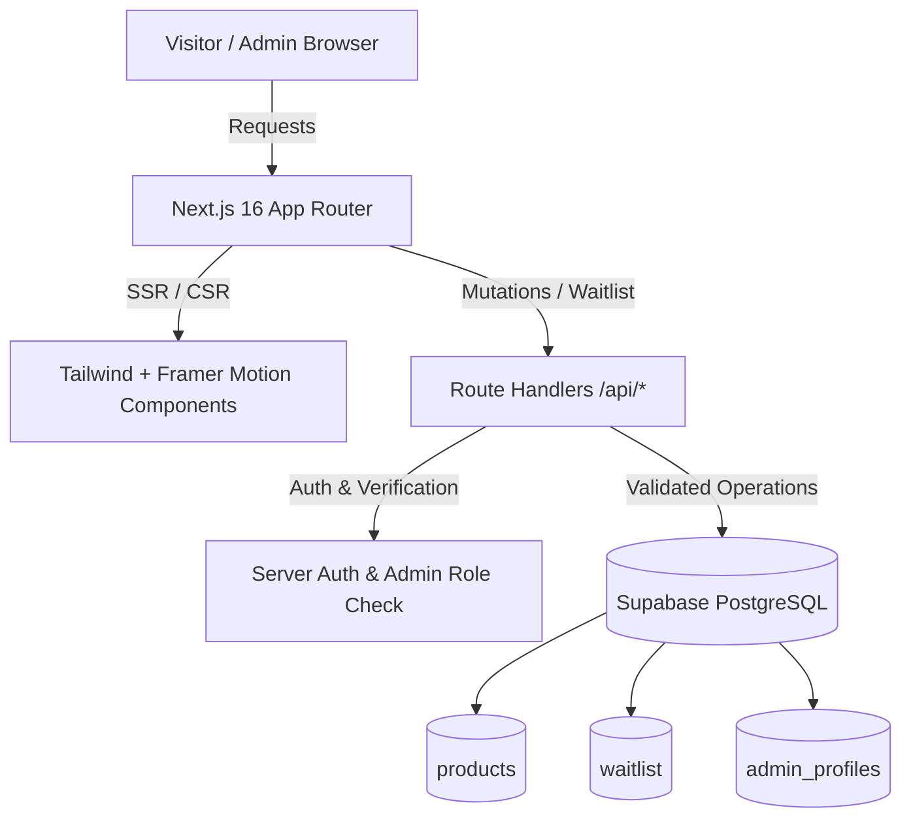

# SneakerDrop — The Art of the Drop

A premium sneaker showcase and product waitlist platform built with **Next.js 16 (App Router)**, **TypeScript**, **Tailwind CSS**, **Framer Motion**, and **Supabase PostgreSQL**. Designed around limited-edition releases, luxury streetwear aesthetics, and persistent database operations.

---

## 🌟 Features

### 🛍️ Public Experience
- **Luxury Editorial Storefront**: Bespoke dark aesthetic (#111111 background, #D7FF45 electric lime accents, Space Grotesk & Inter typography).
- **Hero Silhouette Showcase**: Oversized typography, dynamic entrance animations, floating signature sneaker visual with atmospheric glow.
- **Dynamic Product Catalogue (`/collections`)**: Real-time filtering by category and availability (Available, Limited Drop, Sold Out), instant search, and price sorting.
- **Product Details (`/products/[slug]`)**: Multi-angle image viewer, real-time availability badges, and authenticated waitlist interaction.
- **Product-Specific Waitlists**: Fast modal registration with Zod validation, email normalization, rate limiting, and strict duplicate prevention at database level.
- **Brand Story & Legal (`/about`, `/privacy`, `/terms`)**: Editorial brand manifesto and complete privacy documentation.

### 🛡️ Secure Administrator Console (`/admin`)
- **Dashboard Overview (`/admin`)**: Real-time database metrics (total drops, available, limited, sold out, waitlist signups) and recent activity streams.
- **Full Product CRUD (`/admin/products`)**:
  - Create new sneaker drops with slug generation, image presets/URLs, pricing, and category metadata (`/admin/products/new`).
  - Edit existing sneakers with live cache revalidation (`/admin/products/[id]/edit`).
  - Quick inline availability status switcher.
  - Safe non-cascading product deletion with confirmation dialogs.
- **Waitlist Registry Management (`/admin/waitlist`)**:
  - Filter registrations by sneaker drop and status (`pending`, `notified`, `closed`).
  - Search customer submissions by email.
  - Export complete waitlist registries to CSV with a single click.
  - Update notification status directly.
- **Server-Side Authorization**: Supabase Auth sessions verified via SSR cookies and database role checking (`admin_profiles` table).

---

## 🛠️ Technology Stack

| Component | Technology |
|---|---|
| **Framework** | Next.js 16 (App Router) |
| **Language** | TypeScript (Strict mode) |
| **Styling** | Tailwind CSS v4 |
| **Motion & Animation** | Framer Motion |
| **Icons** | Lucide React |
| **Database** | Supabase PostgreSQL |
| **Authentication** | Supabase Auth (SSR Cookie Sessions) |
| **Validation** | Zod |
| **Form Handling** | React Hook Form |
| **Notifications** | Sonner |
| **Deployment** | Vercel |

---

## 📐 Architecture Diagram



---

## 🗄️ Database Schema & RLS

The database runs on Supabase PostgreSQL with full Row Level Security enabled. Schema files are located in `supabase/migrations/001_initial_schema.sql` and `supabase/seed.sql`.

### 1. `products` Table
```sql
CREATE TABLE products (
  id UUID PRIMARY KEY DEFAULT gen_random_uuid(),
  name TEXT NOT NULL,
  slug TEXT UNIQUE NOT NULL,
  brand TEXT NOT NULL,
  price NUMERIC(10,2) NOT NULL CHECK (price > 0),
  description TEXT NOT NULL,
  image_url TEXT NOT NULL,
  images JSONB DEFAULT '[]'::jsonb,
  category TEXT NOT NULL,
  availability TEXT NOT NULL CHECK (availability IN ('available', 'limited', 'sold_out')),
  is_featured BOOLEAN DEFAULT FALSE,
  created_at TIMESTAMPTZ DEFAULT NOW(),
  updated_at TIMESTAMPTZ DEFAULT NOW()
);
```

### 2. `admin_profiles` Table
```sql
CREATE TABLE admin_profiles (
  id UUID PRIMARY KEY REFERENCES auth.users(id) ON DELETE CASCADE,
  role TEXT NOT NULL DEFAULT 'admin' CHECK (role IN ('admin')),
  created_at TIMESTAMPTZ DEFAULT NOW()
);
```

### 3. `waitlist` Table
```sql
CREATE TABLE waitlist (
  id UUID PRIMARY KEY DEFAULT gen_random_uuid(),
  product_id UUID NOT NULL REFERENCES products(id) ON DELETE RESTRICT,
  email TEXT NOT NULL,
  status TEXT NOT NULL DEFAULT 'pending' CHECK (status IN ('pending', 'notified', 'closed')),
  created_at TIMESTAMPTZ DEFAULT NOW(),
  UNIQUE (product_id, email) -- Enforces duplicate prevention at database level
);
```

### 4. Row Level Security Policies
- **`products`**: Public `SELECT` allowed for store visitors; `INSERT`, `UPDATE`, `DELETE` restricted strictly to verified authenticated admins in `admin_profiles`.
- **`waitlist`**: Public access restricted (no anonymous read/write); insertions managed through validated server-side endpoint with duplicate handling; `SELECT`, `UPDATE`, `DELETE` accessible only by administrators.
- **`admin_profiles`**: Restricted read/write access.

---

## 📁 Folder Structure

```
sneakerdrop/
├── public/
│   └── images/               # Custom vector silhouettes and image assets
├── src/
│   ├── app/
│   │   ├── page.tsx          # Public Landing Page
│   │   ├── layout.tsx        # Root Layout with Space Grotesk & Inter
│   │   ├── globals.css       # Design System Tokens & Dark Theme
│   │   ├── collections/      # Interactive Product Catalogue
│   │   ├── products/[slug]/  # Product Detail & Waitlist Trigger
│   │   ├── about/            # Brand Story & Ethos
│   │   ├── privacy/          # Privacy Policy
│   │   ├── terms/            # Terms of Service
│   │   ├── admin/            # Protected Administrator Portal
│   │   │   ├── login/        # Administrator Login
│   │   │   ├── page.tsx      # Dashboard Overview & Metrics
│   │   │   ├── products/     # Product Management & CRUD
│   │   │   └── waitlist/     # Waitlist Submissions & CSV Export
│   │   └── api/              # Secure Server Endpoints
│   │       ├── products/
│   │       ├── waitlist/
│   │       └── admin/
│   ├── components/
│   │   ├── layout/           # Navbar, Footer
│   │   ├── home/             # Hero, FeaturedSection, BrandStatement, WhyUs, NewsletterCta
│   │   ├── products/         # ProductCard, ProductGrid
│   │   ├── waitlist/         # WaitlistModal
│   │   └── admin/            # AdminSidebar, ProductsManager, WaitlistManager
│   ├── lib/
│   │   ├── auth/             # Server-side Admin Authorization Verification
│   │   ├── data/             # Database Access Layer (Products & Waitlist)
│   │   ├── supabase/         # SSR Client, Browser Client, Service Role Client
│   │   ├── utils/            # Currency formatting, slug generator, color tokens
│   │   └── validations/      # Zod Schemas (Waitlist, Product, Auth)
│   ├── types/                # TypeScript Interfaces
│   └── middleware.ts         # Session Refresh & Route Guard
├── supabase/
│   ├── migrations/           # 001_initial_schema.sql
│   └── seed.sql              # Seed SQL with 3 example drops
├── .env.example
├── package.json
└── tsconfig.json
```

---

## 🚀 Getting Started

### 1. Prerequisites
- Node.js 18.18+ or Node.js 20+
- npm or pnpm
- Supabase account (free tier)

### 2. Clone and Install
```bash
git clone https://github.com/your-username/sneakerdrop.git
cd sneakerdrop
npm install
```

### 3. Supabase Setup
1. Create a new Supabase project at [supabase.com](https://supabase.com).
2. Go to **SQL Editor** in your Supabase project dashboard.
3. Paste and run the contents of `supabase/migrations/001_initial_schema.sql`.
4. Paste and run the contents of `supabase/seed.sql` to populate initial drops:
   - *Air Phantom X* (₹12,999 — Available)
   - *Urban Velocity 01* (₹9,499 — Limited)
   - *Shadow Runner Pro* (₹14,999 — Sold Out)

### 4. Admin Account Provisioning
1. Go to **Authentication > Users** in Supabase and click **Add User** (e.g. `admin@sneakerdrop.com` with a secure password).
2. Copy the newly created user's UUID.
3. In SQL Editor, run:
```sql
INSERT INTO admin_profiles (id, role)
VALUES ('PASTE_USER_UUID_HERE', 'admin');
```

### 5. Environment Variables
Copy `.env.example` to `.env.local` and add your project credentials:
```env
NEXT_PUBLIC_SUPABASE_URL=https://your-project.supabase.co
NEXT_PUBLIC_SUPABASE_ANON_KEY=your-anon-key
SUPABASE_SERVICE_ROLE_KEY=your-service-role-key
ADMIN_EMAIL=admin@sneakerdrop.com
```

### 6. Run Development Server
```bash
npm run dev
```
Open [http://localhost:3000](http://localhost:3000) in your browser.

---

## 🔒 Security Implementation

1. **Server-Side Validation**: All waitlist registrations and product mutations are validated with strict Zod schemas on the server before database execution.
2. **Database Level Uniqueness**: Duplicate waitlist submissions for the same email and sneaker drop are prevented by PostgreSQL `UNIQUE(product_id, email)` constraints, returning a clean `409 Conflict` HTTP status code.
3. **No Secret Leaks**: `SUPABASE_SERVICE_ROLE_KEY` is never referenced in client-side code and is isolated to trusted server operations.
4. **Row Level Security**: Non-admin users cannot perform product insertions or read private waitlist submission entries.
5. **Rate Limiting**: IP-based rate limiting safeguards the waitlist endpoint against bot spamming.

---

## 🚢 Deployment to Vercel

1. Push your repository to GitHub.
2. Import the project in the [Vercel Dashboard](https://vercel.com).
3. Set the Root Directory to `sneakerdrop`.
4. In **Settings > Environment Variables**, add:
   - `NEXT_PUBLIC_SUPABASE_URL`
   - `NEXT_PUBLIC_SUPABASE_ANON_KEY`
   - `SUPABASE_SERVICE_ROLE_KEY`
   - `ADMIN_EMAIL`
5. Click **Deploy**. Vercel will build the application using the zero-error production pipeline.

---

## 📄 License
MIT License © 2026 SneakerDrop Inc.
